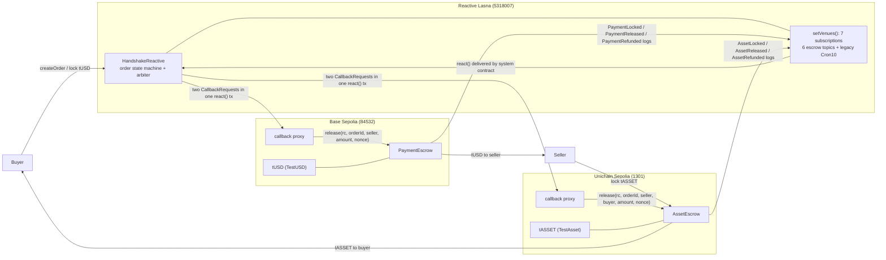
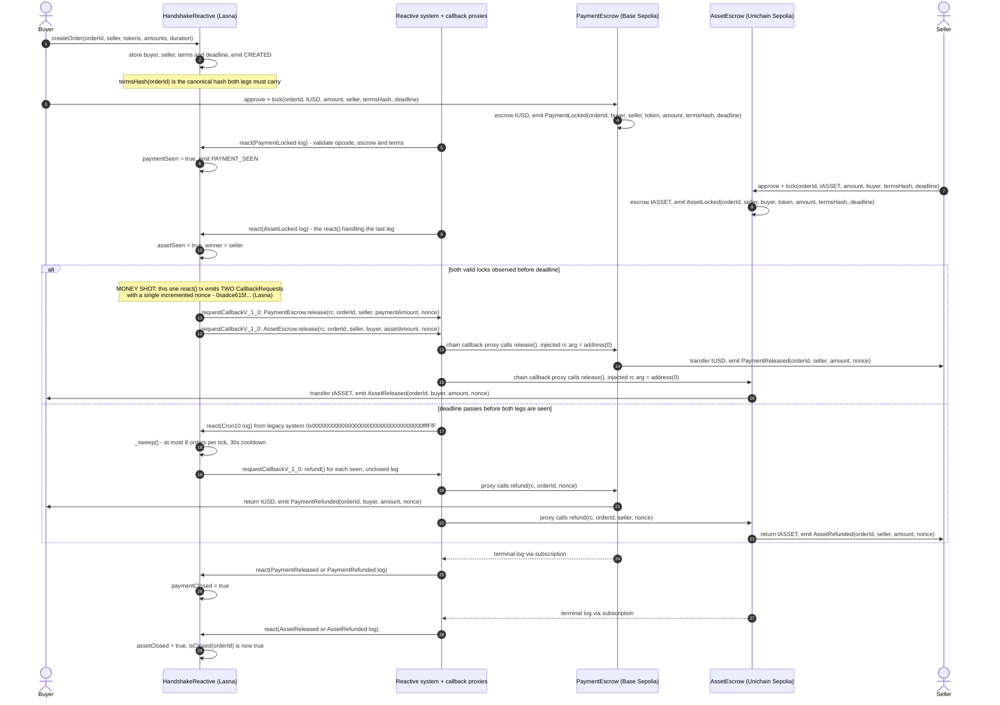

# Handshake contracts

Cross-chain RFQ / OTC settlement primitives for the Handshake demo:

See [TOOLING.md](TOOLING.md) for deployment, funding, preflight, latency observation and proof tooling.

| Contract | Chain | Role |
|---|---|---|
| `src/HandshakeReactive.sol` | Reactive Lasna (5318007) | Neutral arbiter; order state machine; requests both callbacks in one `react()` |
| `src/PaymentEscrow.sol` | Base Sepolia (84532) | Holds the buyer's payment leg |
| `src/AssetEscrow.sol` | Unichain Sepolia (1301) | Holds the asset leg; keyed by `(orderId, seller)` for race mode |
| `src/tokens/TestUSD.sol`, `src/tokens/TestAsset.sol` | Base / Unichain Sepolia | Public-mint demo ERC-20s |

Design notes:

- `setVenues()` installs 6 escrow event subscriptions plus `Cron10` from the legacy system
  contract `0x0000000000000000000000000000000000fffFfF`. `react()` is guarded by
  `onlySystem` and filters both the cron source address and its exact topic0.
- One `uint64` nonce per order is bumped for every callback batch. Escrows require
  `nonce > leg.nonce`, accept callbacks only from the pinned proxy and injected reactive
  sender, and treat `RELEASED` / `REFUNDED` as terminal (repeat callbacks are no-ops).
- Closure is tracked per leg: a single terminal event cannot hide a dropped callback on the
  other leg. `retry(bytes32)` and the bounded (8 orders/tick, 30s cooldown) cron sweep can
  finish the open leg. Late `Locked` logs after a refund decision immediately refund that
  depositor.
- `AssetEscrow` callbacks carry the seller explicitly:
  `release(address,bytes32,address,address,uint256,uint64)` and
  `refund(address,bytes32,address,uint64)`. This is required so a race loser can be
  refunded without touching the winner's leg. As with all callbacks, the first argument is
  reserved for the reactive address injected by the proxy (pass `address(0)`).
- `termsHash(bytes32)` on the reactive contract returns the canonical hash the UI passes
  into `lock()`; a mismatch marks the order invalid and refunds the locked legs.
- `via_ir` is enabled because the public `orders` mapping getter returns the full 22-field
  `Order` struct, which exceeds the legacy EVM stack limit.

Run `forge build && forge test -vv` (36 tests). No deployment or transaction scripts live
in this package.

## Foundry

**Foundry is a blazing fast, portable and modular toolkit for Ethereum application development written in Rust.**

Foundry consists of:

- **Forge**: Ethereum testing framework (like Truffle, Hardhat and DappTools).
- **Cast**: Swiss army knife for interacting with EVM smart contracts, sending transactions and getting chain data.
- **Anvil**: Local Ethereum node, akin to Ganache, Hardhat Network.
- **Chisel**: Fast, utilitarian, and verbose solidity REPL.

## Documentation

https://book.getfoundry.sh/

## Usage

### Build

```shell
$ forge build
```

### Test

```shell
$ forge test
```

### Format

```shell
$ forge fmt
```

### Gas Snapshots

```shell
$ forge snapshot
```

### Anvil

```shell
$ anvil
```

### Deploy

Deployment, funding and verification scripts are maintained in the tooling PR; this package
contains only the contracts and their unit tests.

### Cast

```shell
$ cast <subcommand>
```

### Help

```shell
$ forge --help
$ anvil --help
$ cast --help
```

## Architecture

Handshake is a three-chain DvP: the buyer pays `tUSD` on Base Sepolia, the seller delivers
`tASSET` on Unichain Sepolia, and a single arbiter on Reactive Lasna decides the settlement.
The live flow names the seller explicitly; `createOrder` currently rejects `address(0)` as
seller, so anonymous/open orders are a future extension and are not described here.

### Components and event flow



### Sequence — named-seller settlement



Both callbacks are requested by the same `react()` transaction once both legs are recorded as
seen; the first leg's `react()` only sets its own flag. A single nonce is shared by the release
batch, and escrows accept a callback only when `nonce > leg.nonce`. Each terminal event is
observed back on Lasna and closes only its own leg, so a dropped or late callback can be
finished by `retry()` or the bounded cron sweep rather than silently closing the order.

All three proven loops (payment-first, asset-first and timeout/refund) with their full
transaction hashes are recorded in [DEPLOYMENT.md](DEPLOYMENT.md); the on-chain measurement
methodology and latency numbers are in [LATENCY.md](LATENCY.md).
