# Handshake UI — full Option B screenshots (2026-11-27)

Captured from the rebuilt UI at `http://localhost:4199` (Vite preview of the
`option-b-full` build) with Chrome via Playwright. All mobile shots are 390×844
and were checked for horizontal overflow: `document.documentElement.scrollWidth
=== window.innerWidth` on every page (390 mobile / 1440 desktop).

The screens show the live new system: one reactive contract, per-order venues,
chain flip, token pickers, blank-seller open orders and venue-bound terms hashes.

## Desktop — 1440px

### Home / order book preview
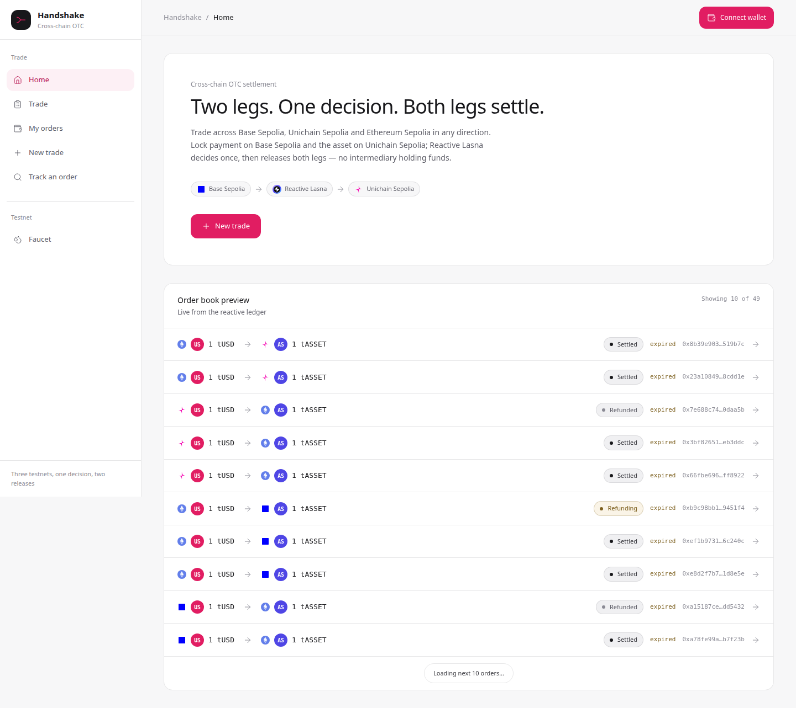

### New trade ticket — chain flip, token pickers, blank seller, venue-bound terms hash
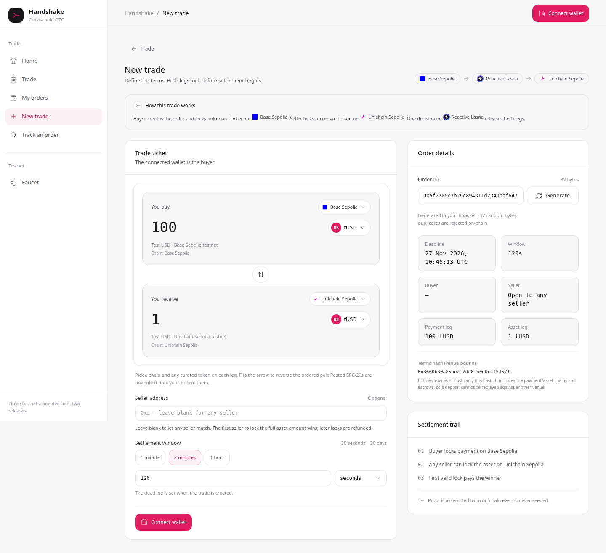

### Order board — chain-pair filter, All/Open/Mine
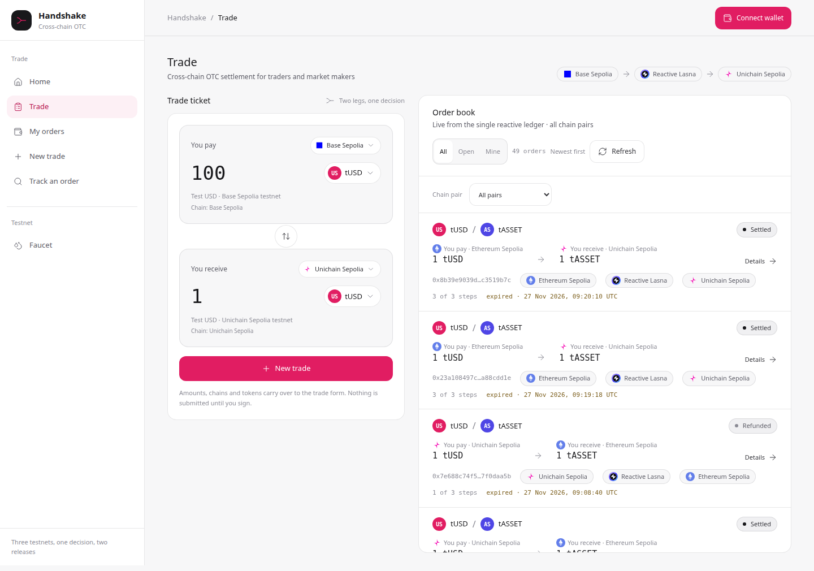

### Faucet — now includes Ethereum Sepolia and its two tokens
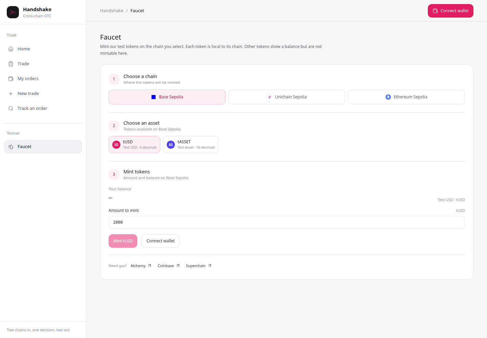

### Bare-order-ID Track / Verify (wallet-free)
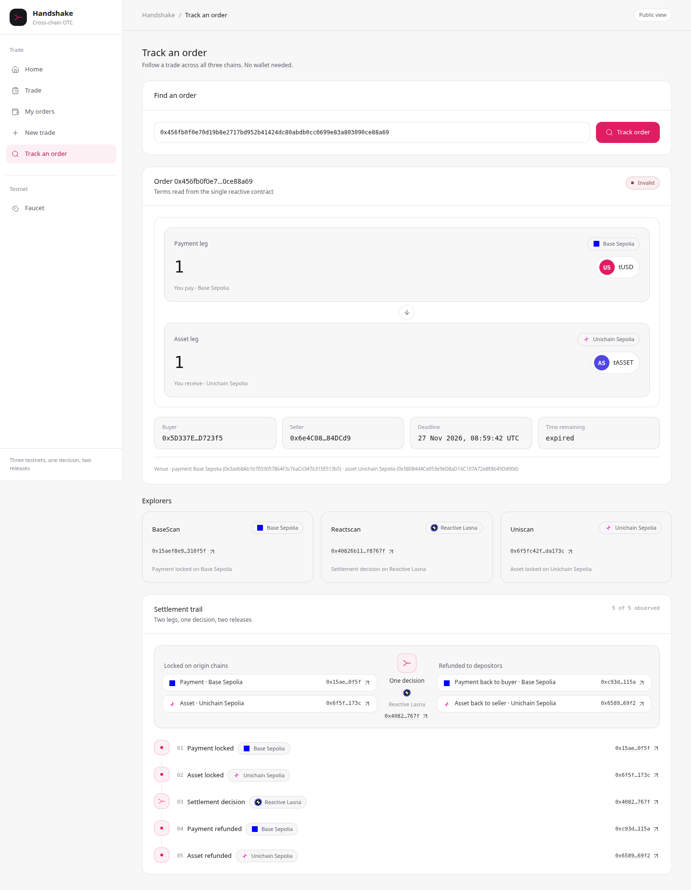

### Wallet connect modal — Browser wallet / WalletConnect
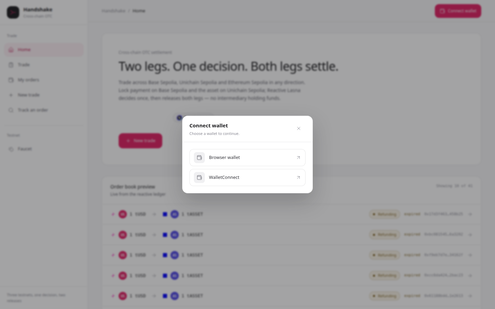

### New trade — explainer uses the resolved ticket token symbols (custom Unverified USDC on Ethereum Sepolia, curated tUSD on Unichain Sepolia)
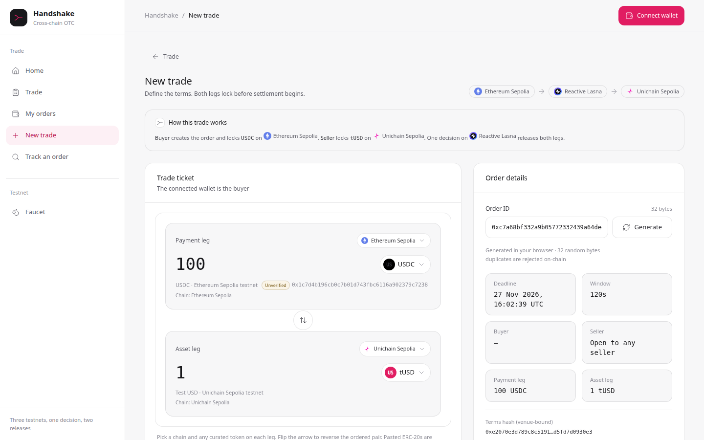

## Mobile — 390px

### Home
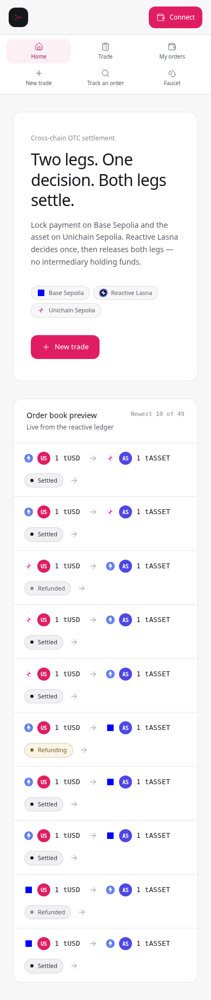

### New trade
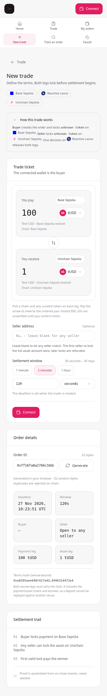

### Order board

### Faucet
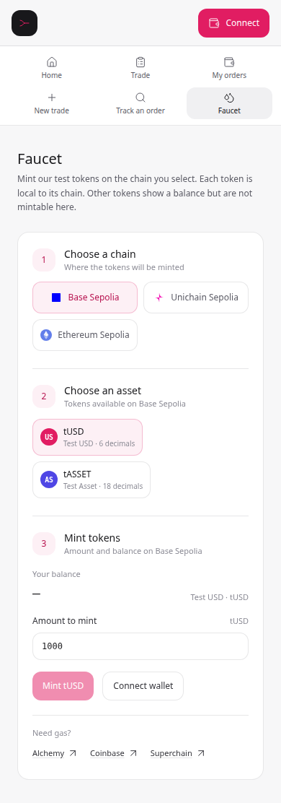

### Wallet connect modal
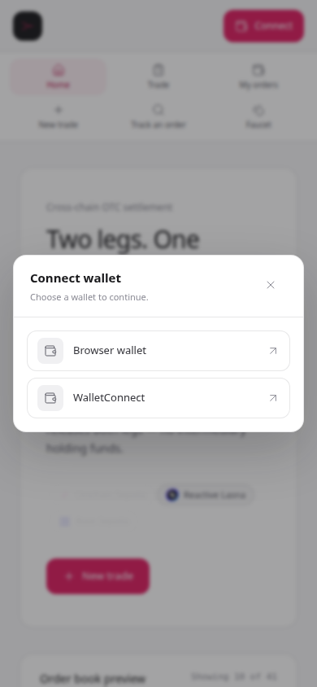

The wallet modal shots were captured with a placeholder WalletConnect project id
in the dev environment so both connector options are visible; no env value is
committed.

## Realtime integration — Phase D (1440px)

Captured from the Vite dev server on `http://localhost:5175` with a local mock
read API/SSE origin (no production data). Both keyboard/mouse paths were checked
for horizontal overflow at 390px and 360px:
`document.documentElement.scrollWidth === window.innerWidth`.

### Global toasts from SSE notifications + live connection / notification centre
The header shows the single `EventSource` connected ("Live updates"), two
unread notifications in the centre, and whitelisted `notification` frames
(`settled`, `counterparty_locked`) rendered as deduped sonner toasts. Raw
`order.state` / `lock.*` frames only patch the query cache — they never toast.
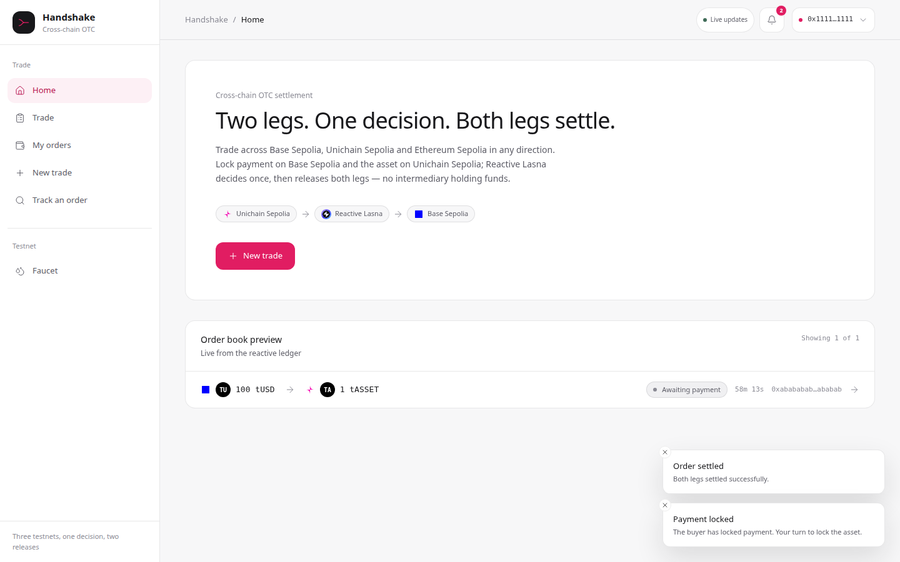

### Confirmation modal before create order
The irreversible write is gated by a modal showing the exact tokens, amounts,
chains, counterparty, deadline, terms hash and a gas note. The same pattern
guards `lock`, `retry` and `cancel`.
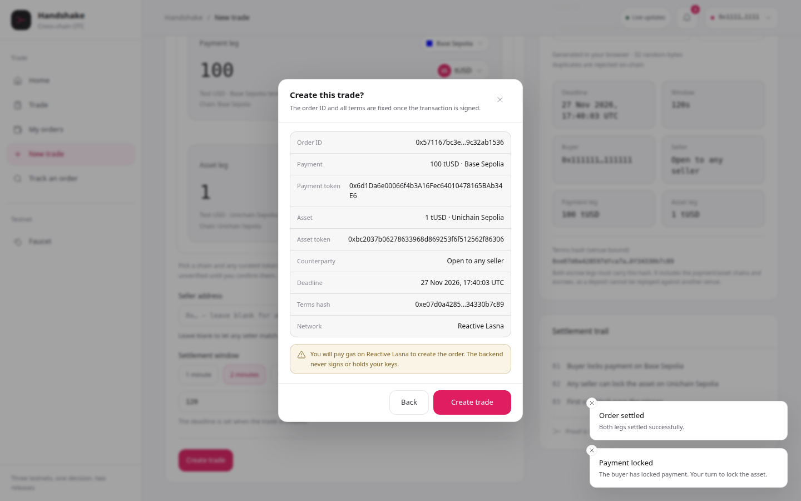

